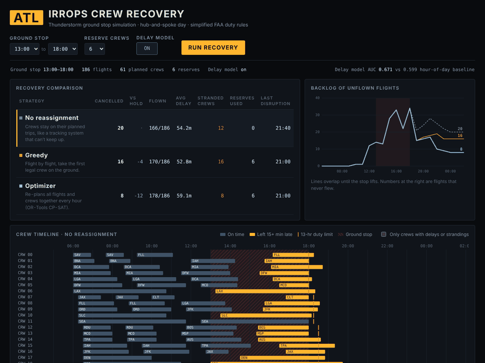
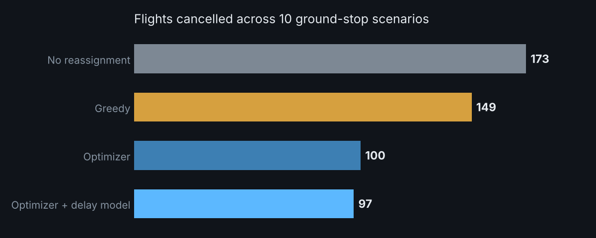
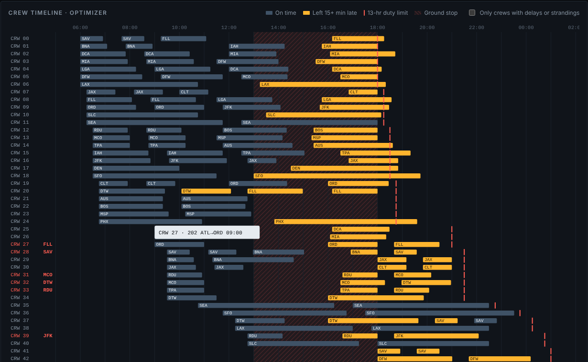
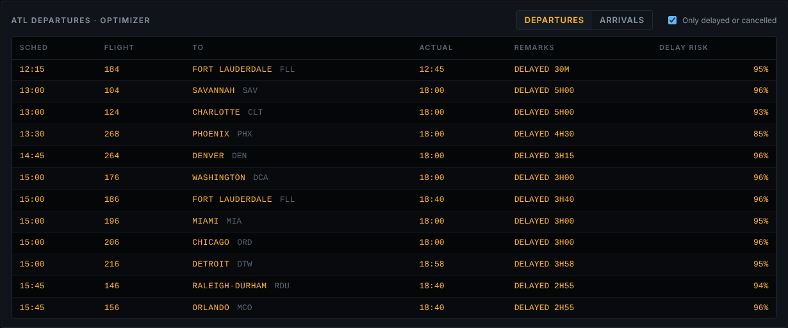
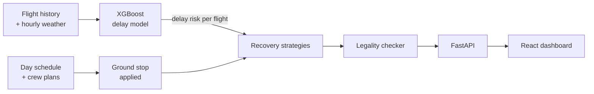

<div align="center">

# ✈️ IRROPS Crew Recovery Engine

**When a thunderstorm shuts down the world's busiest airport, how fast can an airline rebuild its day?**

[](https://github.com/asrithapallaki06/flight-recovery-engine/actions/workflows/ci.yml)




</div>

A full-stack simulation of airline **irregular operations (IRROPS)**. A ground stop hits Atlanta,
crews end up out of position and run into their legal duty limits, and three recovery strategies
compete to save the day. The optimizer, built on Google OR-Tools, **cancels 44% fewer flights**
than holding the original plan.

## 🌩️ The problem

In July 2024, a global IT outage grounded airlines worldwide. Most recovered in a day or two. One
major carrier took about five, because its crew-tracking system
[couldn't process the flood of schedule changes](https://en.wikipedia.org/wiki/2024_Delta_Air_Lines_disruption).
Crews were stuck in the wrong cities or timed out under federal duty limits, so flights that had
planes still couldn't go. More than 7,000 flights were cancelled.

Crew recovery is a hard, real problem: every reassignment has to respect where a crew physically
is, how long it has been on duty, and whether it can still get home. This project builds a small
version of that problem end to end, and measures how much better decisions can be.

## ⚙️ Three ways to recover

| Strategy | How it decides | Weakness |
| --- | --- | --- |
| **Hold the plan** | Every crew stays on its original trip | Crews time out waiting, so their later flights cancel |
| **Greedy** | Flight by flight, take the first legal crew on the ground | Short-sighted: sends tired crews to cities they can't fly home from |
| **Optimizer** | Every hour, solves one assignment problem across all open flights and crews | Needs more computation (still under a second per hour) |

The optimizer's edge comes from three ideas:

- **Look-ahead.** It won't send a crew out on a flight unless that crew will still have enough
  legal duty time to fly home. That's what keeps crews from getting stranded.
- **Batch planning.** Instead of deciding flights one at a time, it plans each hour as a whole,
  so a crew isn't spent on an easy flight when a harder one needs it more.
- **Delay predictions.** An XGBoost model estimates each flight's chance of running late, and the
  optimizer keeps extra duty time in reserve for the risky ones.

```python
# backend/app/recovery/strategies.py: how the optimizer scores each crew-to-flight option
score = 1000 - 2 * delay_minutes          # fly the flight, as close to on time as possible
needed = return_flight_minutes + turn_time
if use_risk:
    needed += int(flight.risk * 30)       # cushion for flights likely to run late
score += 400 if duty_left >= needed else -700   # never strand a crew away from the hub
```

## 📊 Results



Across ten ground stops (2 to 5 hours long, 0 to 8 reserve crews):

| Strategy | Flights cancelled | vs. holding the plan |
| --- | ---: | ---: |
| Hold the plan | 173 | · |
| Greedy | 149 | 14% fewer |
| Optimizer | 100 | 42% fewer |
| **Optimizer + delay model** | **97** | **44% fewer** |

Greedy does only a little better than doing nothing, because the crews it strands cancel flights
later in the day. The delay model adds a modest extra 3%. Reproduce every number with
`scripts/benchmark.py`.

## 🖥️ The dashboard

**Crew timeline.** One row per crew, one bar per flight. Amber bars left late, red ticks mark each
crew's 13-hour duty limit, and red airport codes show where crews ended the night stranded. It's
modeled on the views real crew schedulers work in.



**Flight board.** Every departure and arrival with its delay or cancellation, styled after an
airport gate display.



## 🧠 How it fits together



1. **Delay model.** XGBoost trained on 18,772 hub departures with weather; tested on later dates
   it beats an hour-of-day baseline (**AUC 0.671 vs 0.599**).
2. **Scenario.** 186 flights between ATL and 25 cities, flown by 61 planned crews plus reserves.
3. **Recovery.** The three strategies above, with surprise air-traffic holding delays applied
   identically to each, so the comparison is fair.
4. **Legality checker.** Every plan is replayed against simplified FAA duty rules (13-hour duty
   day, minimum turn time, crew must be at the airport) before results are shown.
5. **API and dashboard.** FastAPI serves the simulation; React draws the timeline, board, and charts.

## 🚀 Run it yourself

**One command, with Docker:**

```bash
docker compose up --build
# open http://localhost:3000
```

**Or run each part (two terminals):**

```bash
# Terminal 1: the API
cd backend
python -m venv .venv
source .venv/bin/activate        # Windows: .venv\Scripts\activate
pip install -r requirements.txt
uvicorn app.main:app --reload    # interactive API docs at http://localhost:8000/docs

# Terminal 2: the dashboard
cd frontend
npm install
npm run dev                      # open http://localhost:5173
```

The first start generates the sample data and trains the delay model automatically.

## 🗂️ Project structure

```
flight-recovery-engine/
├── backend/
│   ├── app/
│   │   ├── config.py           # every rule and setting in one place
│   │   ├── main.py             # FastAPI endpoints
│   │   ├── data/               # sample-data generator and loader
│   │   ├── predictor/          # features, training, and scoring for the delay model
│   │   └── recovery/
│   │       ├── models.py       # Leg and Crew
│   │       ├── rules.py        # duty-limit rules and the plan checker
│   │       ├── scenario.py     # builds the day and applies the ground stop
│   │       ├── strategies.py   # hold, greedy, and the OR-Tools optimizer
│   │       └── simulate.py     # runs and scores all three
│   └── tests/                  # 21 tests: rules, strategies, API
├── frontend/src/
│   ├── App.jsx
│   └── components/             # CrewTimeline, DeparturesBoard, Scoreboard, BacklogChart
├── scripts/
│   ├── benchmark.py            # reproduces the results above
│   └── download_bts.py         # swaps in real DOT flight and NOAA weather data
├── docs/                       # README images
└── docker-compose.yml
```

## 🧪 Tests

```bash
cd backend && pytest -v
```

The suite checks that every strategy produces a fully legal plan in several scenarios, that no
flight leaves during the ground stop, that the optimizer never cancels more than holding the plan,
and that the API validates its inputs. GitHub Actions runs it, plus a frontend build, on every push.

## 📡 Using real data

The sample data uses the same columns as the U.S. DOT Bureau of Transportation Statistics
On-Time Performance dataset, so real data drops straight in:

```bash
pip install meteostat
python scripts/download_bts.py --year 2025 --months 6 7 8
cd backend && python -m app.predictor.train
```

## 🔭 Limitations and next steps

- Crew schedules are synthetic, since real ones aren't public, and duty rules are a simplified
  version of FAA Part 117.
- Aircraft routing isn't modeled: the simulation assumes a plane is available for every flight.
- One hub and one day, with no overnight rest or multi-day trips.

Natural next steps: add aircraft as a second resource, extend to multi-day recovery, and stream
schedule changes through a message queue to model a high volume of real-time updates.

---

<div align="center">

Built by **Asritha Pallaki** · Computer Science + Business at the University of Georgia

[LinkedIn](https://www.linkedin.com/in/asritha-pallaki-0469b031a) · [GitHub](https://github.com/asrithapallaki06)

</div>
