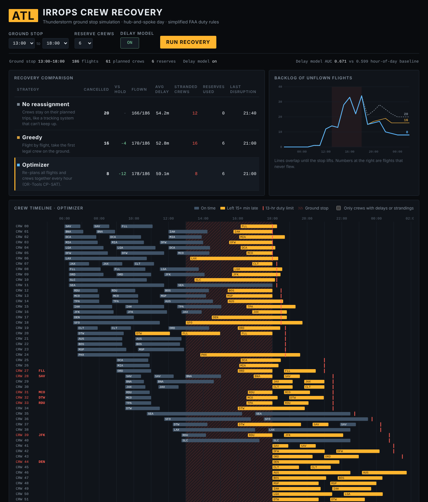
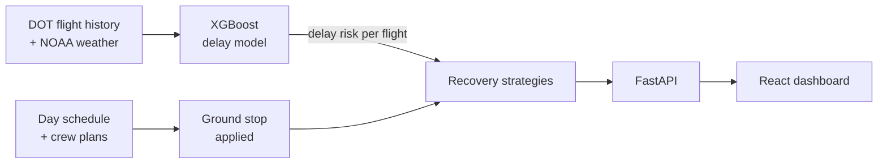

# Crew Recovery Engine

**When a storm shuts down a hub airport, how fast can an airline rebuild its day?**

This project simulates a ground stop at Atlanta (ATL) and compares three ways to reassign
flight crews afterward. The optimizer, built with Google OR-Tools, cancels **44% fewer
flights** than keeping crews on their original plans, and **35% fewer** than a greedy
first-available approach, across ten ground-stop scenarios.

It was inspired by the July 2024 airline IT disruption, when crew-tracking software couldn't
keep up with a flood of schedule changes. Crews ended up out of position or past their legal
duty limits, and recovery took days.



## How it works



1. **Delay model** (`backend/app/predictor`). An XGBoost classifier predicts the chance each
   departure is 15+ minutes late, from time of day, route, carrier, and weather. It beats an
   hour-of-day baseline: **AUC 0.671 vs 0.599** on held-out later dates.
2. **Scenario** (`backend/app/recovery/scenario.py`). One day of hub-and-spoke flying: 186
   flights to 25 cities, 61 planned crews plus reserves. A ground stop blocks all departures
   from and arrivals into ATL for the chosen window.
3. **Recovery strategies** (`backend/app/recovery/strategies.py`):
   - **No reassignment.** Crews stay on their planned trips no matter what.
   - **Greedy.** Flight by flight, take the earliest legal crew available.
   - **Optimizer.** Every hour, solve an assignment problem with OR-Tools CP-SAT across all
     open flights and crews. It looks ahead so it never sends a crew to a city it can't legally
     fly home from, and it uses the delay model to keep extra duty time for risky flights.
4. **Legality checker** (`backend/app/recovery/rules.py`). Simplified FAA duty rules: a
   13-hour duty day, minimum turn times, and crews must be at the departure airport. Every plan
   is replayed and checked before results are returned.

## Results

Total cancellations across ten ground-stop scenarios (2 to 5 hours, 0 to 8 reserve crews):

| Strategy | Cancellations | vs. no reassignment |
| --- | --- | --- |
| No reassignment | 173 | baseline |
| Greedy | 149 | 14% fewer |
| Optimizer | 100 | 42% fewer |
| Optimizer + delay model | 97 | 44% fewer |

The delay model adds a small gain of about 3%. The optimizer completes more flights, so its
average delay on flown flights is sometimes slightly higher: it flies late flights the other
strategies cancel.

## Run it

**With Docker** (one command):

```bash
docker compose up --build
# open http://localhost:3000
```

**Without Docker** (two terminals):

```bash
# Terminal 1: backend
cd backend
python -m venv .venv && source .venv/bin/activate   # Windows: .venv\Scripts\activate
pip install -r requirements.txt
uvicorn app.main:app --reload        # API at http://localhost:8000/docs

# Terminal 2: frontend
cd frontend
npm install
npm run dev                          # dashboard at http://localhost:5173
```

The first start generates sample data and trains the model automatically.

**Tests:** `cd backend && pytest` (21 tests: legality of every strategy, ground-stop rules, API).

## Using real data

The sample data uses the same columns as the U.S. DOT BTS On-Time Performance dataset. To use
real ATL flights and weather:

```bash
pip install meteostat
python scripts/download_bts.py --year 2025 --months 6 7 8
cd backend && python -m app.predictor.train
```

## Limitations

- Crew plans are synthetic, since real crew schedules aren't public. Duty rules are simplified
  versions of FAA Part 117.
- Aircraft routing isn't modeled; the simulation assumes a plane is available for each flight.
- One hub and one day; no overnight rest or multi-day trips.

## Tech

Python · FastAPI · XGBoost · scikit-learn · Google OR-Tools (CP-SAT) · pandas · React · Vite ·
Docker · nginx · pytest
