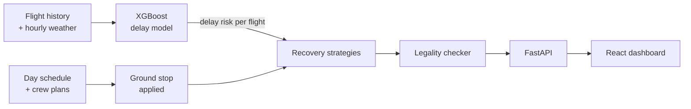

# IRROPS Crew Recovery Engine

[](https://github.com/asrithapallaki06/flight-recovery-engine/actions/workflows/ci.yml)


A simulation of how an airline reassigns its crews after a thunderstorm shuts down Atlanta.
It compares three recovery strategies, and an optimizer built on Google OR-Tools cancels 44%
fewer flights than keeping crews on their original plans.


## Why I built this

During the July 2024 IT outage, most airlines were flying normally within a day or two. One major
carrier took about five days and cancelled more than 7,000 flights, largely because its
crew-tracking system [couldn't keep up with the volume of schedule changes](https://en.wikipedia.org/wiki/2024_Delta_Air_Lines_disruption).
Crews were stuck in the wrong cities or past their legal duty limits, so planes sat on the ground
with no one allowed to fly them.

I wanted to understand why crew recovery is so hard, so I built a small version of the problem:
one hub, one day, a ground stop, and the duty rules crews have to follow.

## How the strategies compare

| Strategy | How it decides | Where it falls short |
| --- | --- | --- |
| Hold the plan | Every crew stays on its original trip | Crews time out while waiting, and their later flights cancel |
| Greedy | Flight by flight, take the first legal crew on the ground | Sends tired crews to cities they can't legally fly home from |
| Optimizer | Every hour, solves one assignment problem across all open flights and crews | Slower, though still under a second per hour of the day |

Three things make the optimizer work:

- **It looks ahead.** It won't send a crew out unless that crew will still have enough duty time
  left to fly back to the hub. This is what keeps crews from getting stranded.
- **It plans an hour at a time.** Deciding all of an hour's flights together keeps it from using
  up a crew on an easy flight when a harder one needs it more.
- **It uses delay predictions.** An XGBoost model estimates each flight's chance of running late,
  and the optimizer saves extra duty time for the risky ones.

The core of the scoring, simplified from `backend/app/recovery/strategies.py`:

```python
score = 1000 - 2 * delay_minutes                 # fly it, as close to on time as possible
needed = return_flight_minutes + turn_time
if use_risk:
    needed += int(flight.risk * 30)              # cushion for flights likely to run late
score += 400 if duty_left >= needed else -700    # don't strand a crew away from the hub
```

## Results


Across ten ground stops, ranging from 2 to 5 hours with 0 to 8 reserve crews:

| Strategy | Flights cancelled | vs. holding the plan |
| --- | ---: | ---: |
| Hold the plan | 173 | |
| Greedy | 149 | 14% fewer |
| Optimizer | 100 | 42% fewer |
| Optimizer + delay model | 97 | 44% fewer |

Greedy barely beats doing nothing. It strands crews early in the recovery, and those crews'
flights cancel later in the day. The delay model helps, but only by about 3%. `scripts/benchmark.py`
reproduces all of these numbers.

## The dashboard

The crew timeline shows one row per crew and one bar per flight across the day. Amber bars left
late, red ticks mark each crew's 13-hour duty limit, and a red airport code means the crew ended the
night stranded there. Crew schedulers work in a similar view.


The flight board lists every departure and arrival with its delay or cancellation.


## How it's built



- **Delay model:** XGBoost trained on 18,772 hub departures with weather. On later dates it scores
  an AUC of 0.671, against 0.599 for a baseline that only uses the hour of day.
- **Scenario:** 186 flights between ATL and 25 cities, flown by 61 planned crews plus reserves.
  Surprise holding delays are applied the same way to every strategy, so the comparison is fair.
- **Legality checker:** every plan is replayed against simplified FAA duty rules (a 13-hour duty
  day, minimum turn time, and crews must be at the airport) before results are shown.
- **Stack:** Python, FastAPI, OR-Tools (CP-SAT), XGBoost, scikit-learn, pandas, React, Vite,
  Docker, and GitHub Actions.

## Running it

With Docker:

```bash
docker compose up --build
# then open http://localhost:3000
```

Without Docker, in two terminals:

```bash
# API
cd backend
python -m venv .venv
source .venv/bin/activate        # Windows: .venv\Scripts\activate
pip install -r requirements.txt
uvicorn app.main:app --reload    # API docs at http://localhost:8000/docs

# Dashboard
cd frontend
npm install
npm run dev                      # open http://localhost:5173
```

The first run generates sample data and trains the delay model automatically.

## Project layout

```
backend/app/
  config.py             rules and settings
  main.py               API endpoints
  data/                 sample-data generator and loader
  predictor/            delay model features, training, scoring
  recovery/
    rules.py            duty limits and the plan checker
    scenario.py         builds the day and applies the ground stop
    strategies.py       hold, greedy, and the optimizer
    simulate.py         runs and scores all three
backend/tests/          21 tests
frontend/src/components CrewTimeline, DeparturesBoard, Scoreboard, BacklogChart
scripts/                benchmark.py, download_bts.py
```

## Tests

```bash
cd backend && pytest -v
```

The tests check that every strategy produces a fully legal plan, that nothing departs during the
ground stop, that the optimizer never cancels more than holding the plan, and that the API rejects
bad input. GitHub Actions runs them on every push.

## Real data

The sample data uses the same columns as the U.S. DOT's On-Time Performance dataset, so real data
can be swapped in:

```bash
pip install meteostat
python scripts/download_bts.py --year 2025 --months 6 7 8
cd backend && python -m app.predictor.train
```

## Limitations

- Crew schedules are synthetic, since real ones aren't public. The duty rules are a simplified
  version of FAA Part 117.
- Aircraft aren't modeled. The simulation assumes a plane is always available.
- It covers one hub and one day, with no overnight rest or multi-day trips.

Next, I'd like to add aircraft as a second resource, extend recovery across multiple days, and
feed schedule changes through a message queue to model high-volume real-time updates.

## About

Built by Asritha Pallaki, Computer Science and Business at the University of Georgia.
[LinkedIn](https://www.linkedin.com/in/asritha-pallaki-0469b031a)
